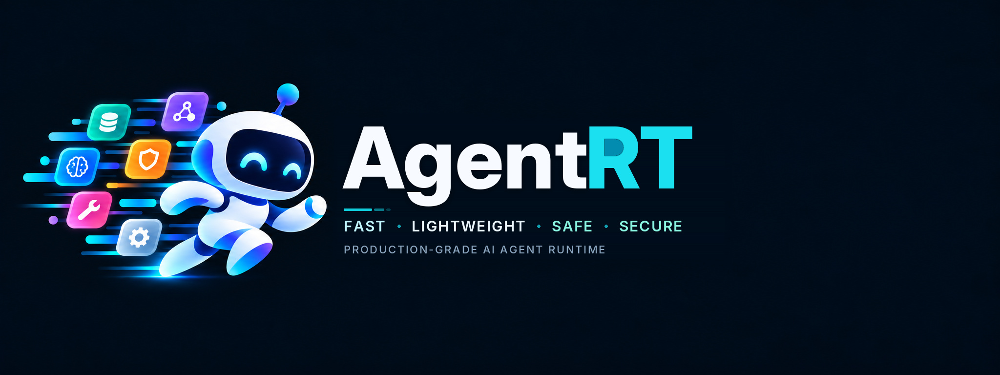
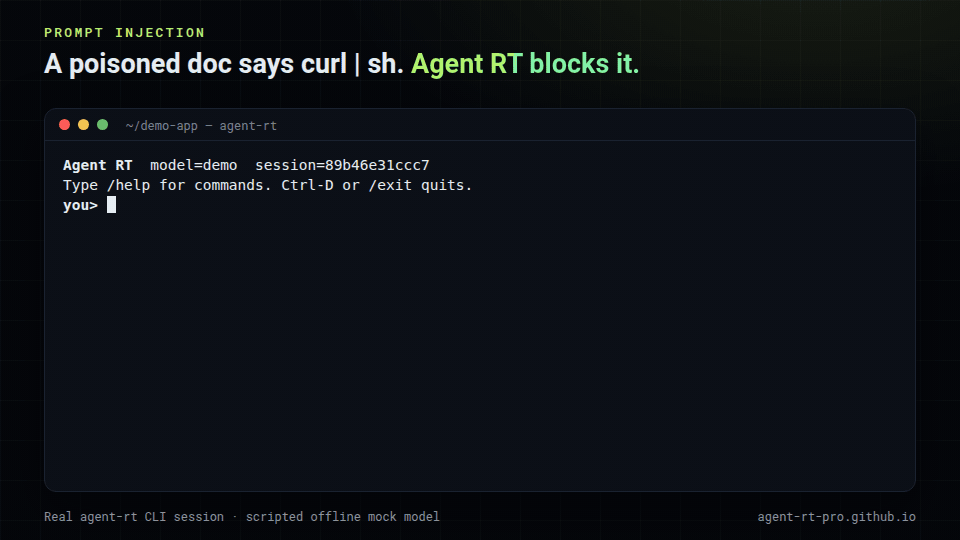
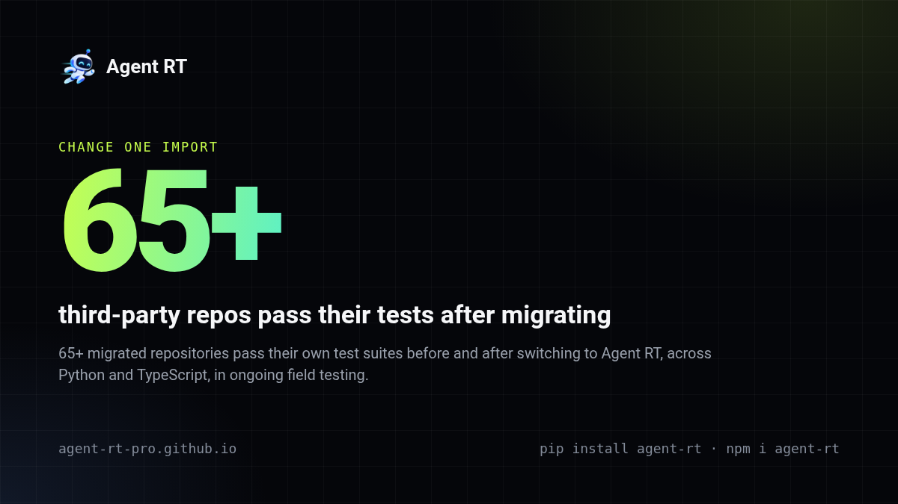

**Production AI agents without the framework tax: in Python and TypeScript.** ⚡

Agent RT gives agents a clear execution boundary for **tools, streaming, structured output, permissions, approvals, memory, checkpoints, sandboxing, observability, and deployment**—without requiring a heavyweight orchestration stack.

> **One runtime. Two languages. Any model provider. Production controls built in.** 🧩

[](https://pypi.org/project/agent-rt/)
[](https://www.npmjs.com/package/agent-rt)
[](https://agent-rt-pro.github.io/docs/)
[](https://github.com/Pro-GenAI/Agent-RT/blob/main/LICENSE)
<a href="https://pepy.tech/projects/agent-rt"></a>


<!-- [](https://pepy.tech/projects/agent-rt) -->
<!-- [](https://pepy.tech/projects/agent-rt) -->
<!-- [](https://pepy.tech/projects/agent-rt) -->

## 🤖 Meet Artie

Artie (A·R·T, for Agent RT) is the running robot in the logo, and greets you in the terminal when `agent-rt` starts. `artie` is a command alias: `artie migrate`, `artie demo`, and every other `agent-rt` command and option work the same. Its three flagship features have names:

- 🛡️ **Guard** — action blockers, including [Agent Action Guard](docs/Runtime-Guide.md#action-blockers), stop a harmful tool call before it runs.
- ♻️ **Checkpoints** — resume a run with the turn, tool-call, and token budgets it had already used.
- 🧱 **Wall** — the [migration wall](https://agent-rt-pro.github.io/): 65+ third-party repositories that pass their tests before and after migrating.

Each release also gets a one-word codename; the current one is **Sprint**.

## 📈 By the Numbers

- 🪙 **8–37× fewer input tokens** per prompt than Codex, Claude Code, opencode, and Copilot CLI
- 🧠 **5–14× less memory** per CLI process than the same agent CLIs
- 📦 **66× smaller npm install** than LangChain.js (1.24 MiB vs 82.44 MiB)
- ⚡ **5.8× less framework overhead** than LangChain in Python (1.56 ms vs 9.03 ms warm)
- 🔄 **65+ third-party repositories** pass their tests before and after migration


<sub>Measured against deterministic localhost mock models, so the numbers show runtime and harness overhead, not model latency or task quality. Part of the CLI token gap comes from Agent RT's smaller built-in tool set. Method and raw data: [`comparison/`](comparison/README.md).</sub>



**Runs on:**

    

## 🚀 Quick Start

**Python**

```bash
pip install agent-rt
```

**TypeScript / Node.js**

```bash
npm install agent-rt
```

**⏱️ Try it in 10 seconds** with the API key you already use for Claude Code, Codex, opencode, or Copilot CLI (no config file needed):

```bash
pip install 'agent-rt[cli,anthropic]'
agent-rt claude -p "explain this stack trace"   # or: agent-rt codex exec "..." · agent-rt opencode run "..." · agent-rt copilot -p "..."
```

Only API-key setups are reused; subscription sign-ins stay with the official clients ([details](docs/website/docs/guides/runtime-guide.html#reuse-another-agent-cli)).

➡️ [Installation](docs/website/docs/getting-started/installation.html) · [Quickstart](docs/website/docs/getting-started/quickstart.html)

## 🔄 Migrate by Changing One Import

```diff
- from openai import OpenAI
+ from agent_rt.openai import OpenAI
```

```diff
- import OpenAI from "openai";
+ import OpenAI from "agent-rt/openai";
```

The same prefix works for supported subsets of Anthropic, OpenRouter, LangChain, Deep Agents, LlamaIndex, and OpenAI Agents (plus LiteLLM, AutoGen, and CrewAI in Python). See the [migration guide](docs/website/docs/guides/migration.html).

Or run `uvx agent-rt migrate` (Python) or `npx agent-rt migrate` (TypeScript/JavaScript) in your project. It runs your tests before and after the rewrite and keeps it only if nothing new fails: every test that fails afterwards must have failed before, in the same test at the same line. Otherwise every file is restored. It then prints a before-and-after card (tests, test time, peak memory, package size) and, for a GitHub repository, a pre-filled issue link to add it to the migration wall. See [automatic migration](docs/MIGRATION.md#automatic-migration-agent-rt-migrate).



## ✨ Why Agent RT?

- 🪶 **Lightweight and measurable** — start with the runtime core and add integrations only when needed; reproducible cross-framework benchmarks live in [`comparison/`](comparison/README.md).
- 🛡️ **Controlled** — permissions, composable action blockers, approvals, deterministic PII morphing, limits, guardrails, and sandbox boundaries are runtime concepts, not add-ons.
- 🔌 **Provider-neutral, two languages** — OpenAI, Anthropic, compatible endpoints, or custom providers, with aligned contracts in  Python and  TypeScript.
- 🔄 **Migration-tested** — ongoing compatibility field testing has 65+ third-party repositories passing their test suites both before and after migration to Agent RT.

**Decision models** (such as Laya and other Jev-compatible models) answer typed choice/score questions for runtime control-plane gates instead of generating text. `Toolbase` can combine local, deferred, and MCP tools, remove unsafe definitions with a Decision model, pass only the relevant subset to each turn, and keep `tool_search` available for safe fallback discovery; the same Decision layer also gates memory, reranks retrieval results with optional top-k selection, and classifies failures.

## ⚖️ Quick Comparison

| | ⚡ Agent RT | 🦜 LangChain | 🗂️ LlamaIndex |
| --- | --- | --- | --- |
| **🎯 Primary focus** | 🧠 Agent runtime | 🧩 App/orchestration framework | 📚 Data & RAG framework |
| ** Python +  TypeScript** | ✅ | ✅ | ✅ |
| **🛠️ Tools & agent loop** | ✅ Built-in | ✅ | ✅ |
| **🔐 Permissions & approvals** | ✅ Built-in | ◐ | ◐ |
| **🛡️ Agent Action Guard** | ✅ Built-in integration (opt-in) | — | — |
| **🧰 API & CLI tools** | ✅ Built-in (optional packages) | — | — |
| **🌐 OpenAI + Anthropic compatible API** | ✅ Built-in server adapters | ◐ Integration-dependent | ◐ Integration-dependent |
| **🧠 Decision-model control gates** | ✅ Tool pruning, memory/retrieval gates, failure classification | — | — |
| **✂️ Tool catalog pruning before model call** | ✅ Built-in | ◐ Integration-dependent | ◐ Integration-dependent |
| **📦 Sandboxing** | ✅ Fail-closed backend selection | ◐ | ◐ |
| **♻️ Budget-preserving checkpoints** | ✅ Resume with prior turn/tool/token budgets | ◐ | ◐ |
| **💾 Memory & checkpoints** | ✅ Built-in | ✅ | ✅ |
| **🗃️ Switch vector DBs** | ✅ One `agent-rt.yaml` registry switch | ◐ Integration-dependent | ◐ Integration-dependent |
| **🔁 Post-retrieval reranking** | ✅ Built-in provider-neutral hook + optional top-k | ◐ Available | ◐ Available |
| **🔌 Provider-neutral** | ✅ | ✅ | ✅ |
| **🪶 Lightweight runtime focus** | ✅ | ◐ | ◐ |
| ** Fresh install footprint** | **46.43 MiB** | 69.87 MiB | 219.91 MiB |
| ** Warm latency** | **1.56 ms** | 9.03 ms | 4.26 ms |
| ** Runtime memory** | **+5.86 MiB** | +19.77 MiB | +22.42 MiB |
| ** Fresh install footprint** | **1.24 MiB** | 82.44 MiB | 60.38 MiB |
| ** Warm latency** | **1.85 ms** | 2.60 ms | 2.23 ms |
| ** Runtime memory** | **+14.33 MiB** | +17.27 MiB | +16.79 MiB |

**✅ Built-in · ◐ Available / integration-dependent · — Not a primary focus**

📊 [See reproducible benchmarks →](comparison/README.md)

## 🧪 See It in Action

A tool the model may call, restricted by a capability grant and a model-call budget (Python shown; see the [TypeScript package](typescript/README.md) for the npm quick start):

```python
registry = ToolRegistry()
registry.register(
    ToolDefinition(
        name="get_weather",
        description="Get the current weather for a city.",
        input_schema={
            "type": "object",
            "required": ["city"],
            "properties": {"city": {"type": "string"}},
            "additionalProperties": False,
        },
        side_effect="read",
    ),
    handler=get_weather,  # async (arguments, cancellation_token) -> dict
)

loop = AgentLoop(
    load_model(load_config()),  # models from agent-rt.yaml: OpenAI, Anthropic, or compatible endpoints
    tool_registry=registry,
    capability_grant=CapabilityGrant(tools=("get_weather",)),
    execution_budget=ExecutionBudget(ExecutionBudgetLimits(max_model_calls=5)),
)
result = await loop.run(agent, messages)
```

Arguments are validated against the schema, tools outside the grant never run, and the budget stops runaway loops. Full runnable versions are in the [examples](python/examples/README.md).

## 📚 Learn More

| Topic | Documentation |
| --- | --- |
| Runtime model | [How Agent RT executes agents](docs/website/docs/concepts/runtime.html) |
| Tools & safety | [Tools, policy, permissions, approvals, and guardrails](docs/website/docs/concepts/tools-policy.html) |
| State & memory | [State, memory, checkpoints, and artifacts](docs/website/docs/concepts/state-memory.html) |
| Production | [Sandboxing, observability, evaluation, and deployment](docs/website/docs/guides/production.html) |
| Migration | [LangChain, LlamaIndex, OpenAI, and Anthropic migration](docs/website/docs/guides/migration.html) |
| Runtime guide | [Providers, API server, CLI, sandboxes, skills, and migration entry points](docs/website/docs/guides/runtime-guide.html) |
| Features | [Features, defaults, and configuration](docs/website/docs/reference/features-defaults.html) |
| Architecture | [Architecture and extension contracts](docs/website/docs/reference/architecture.html) |
| Development | [Contributor setup and test workflows](docs/website/docs/reference/development.html) |

🌐 **Full documentation:** [agent-rt-pro.github.io/docs](https://agent-rt-pro.github.io/docs/)

## 📦 Packages

[Python](python/README.md) · [TypeScript](typescript/README.md) · [Python examples](python/examples/README.md) · [TypeScript examples](typescript/examples/README.md)

The inbound API server, terminal CLI, and AutoGen/CrewAI/LiteLLM migration shims are Python-only.

## 📄 License

MIT — see [LICENSE](LICENSE).

---

<p align="center">

<br>
<em>Projects for Next-Gen AI</em>
</p>
