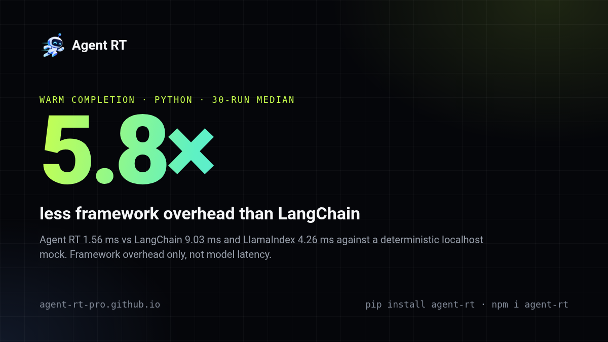

# Agent RT for Python

**Production AI agents without the framework tax.** A lightweight, provider-neutral runtime with explicit control over tools, safety, state, and orchestration.

🌐 **[Website](https://agent-rt.pro-genai.com/)** · [Documentation](https://agent-rt.pro-genai.com/docs/) · [GitHub](https://github.com/Pro-GenAI/Agent-RT) · [Docker Hub](https://hub.docker.com/r/praneeth1v/agent-rt-python)

[](https://hub.docker.com/r/praneeth1v/agent-rt-python)
[](https://hub.docker.com/r/praneeth1v/agent-rt-python)

Meet **Artie**, the running robot, and its flagship features: **Guard** (blocks harmful tool calls before they run), **Checkpoints** (resume with budgets intact), and the migration **Wall** (65+ repositories passing their tests after migrating).

[](https://github.com/Pro-GenAI/Agent-RT/tree/main/src/comparison)

The `agent-rt` CLI also sends **6–22× fewer input tokens per prompt** than Codex, Claude Code, opencode, and Copilot CLI, with 5–10× less memory. All numbers come from deterministic localhost mocks and measure runtime overhead, not model latency or task quality ([method and data](https://github.com/Pro-GenAI/Agent-RT/tree/main/src/comparison)).

Start with an OpenAI-compatible endpoint, then add tools, approvals, memory, sandboxing, retrieval, and multi-agent orchestration without replacing your runtime. `asyncio`-native, with an optional API server and terminal CLI.

## Why Agent RT?

- **Provider-neutral.** OpenAI-compatible endpoints, OpenAI, Anthropic, or your own `ModelProvider`.
- **Safe by construction.** Tool validation, permissions, composable action blockers, approvals, deterministic PII morphing, guardrails, budgets, and deadlines are runtime primitives.
- **Scales large tool catalogs.** `Toolbase` combines local/deferred and MCP tools, safety-screens them, sends only the relevant subset per turn, and keeps `tool_search` available for fallback discovery.
- **Small core.** OpenAI support is included; Anthropic, API serving, CLI, and sandboxes are opt-in extras.
- **Production-ready.** Checkpoints, event streams, queues, tracing, cost ledgers, retrieval with post-retrieval reranking, and multi-agent patterns.
- **Decision models.** Jev-compatible models, or the OpenAI-compatible Decisions API answer typed questions that gate tool safety, tool relevance, memory, and retrieval ([details](https://agent-rt.pro-genai.com/docs/guides/runtime-reference#action-blockers)).
- **Easy to adopt.** Migration-compatible entry points for supported subsets of OpenAI, Anthropic, OpenRouter, LiteLLM, LangChain, Deep Agents, LlamaIndex, OpenAI Agents, AutoGen, and CrewAI code; across Agent RT's ongoing migration field testing, 65+ third-party repositories pass before and after migration.

## Install

Python 3.10–3.14. Runs on Linux, Windows, macOS (Intel and Apple M-series), and Raspberry Pi.

```bash
pip install agent-rt
pip install 'agent-rt[all]'   # or pick extras: anthropic, observability, api, cli
```

**Docker Hub:** The prebuilt [Python image](https://hub.docker.com/r/praneeth1v/agent-rt-python) includes the `agent-rt` CLI entrypoint and the provider, API, and web extras. Pull the latest tag (or a published version tag) and try the CLI:

```bash
docker pull praneeth1v/agent-rt-python:latest
docker run --rm praneeth1v/agent-rt-python:latest --help
```

Works with the `openai` (1.31+, including 2.x and 3.x) and `anthropic` (0.29+, including 1.x) SDK versions your project already pins — any release since mid-2024.

OpenLLMetry/Traceloop export is optional. Install `agent-rt[observability]` only when TRACELOOP-based telemetry is needed; the core runtime does not require it.

**Try it in 10 seconds** with the API key you already use for Claude Code, Codex, opencode, or Copilot CLI (no config file needed):

```bash
pip install 'agent-rt[cli,anthropic]'
agent-rt claude -p "explain this stack trace"   # or: agent-rt codex exec "..." · agent-rt opencode run "..." · agent-rt copilot -p "..."
```

Only API-key setups are reused; subscription sign-ins stay with the official clients ([details](https://agent-rt.pro-genai.com/docs/guides/runtime-guide#reuse-another-agent-cli)).

## Migrate in one line

```diff
- from openai import OpenAI
+ from agent_rt.openai import OpenAI
```

Prepend `agent_rt.` to a supported import, for example `from agent_rt.langchain_openai import ChatOpenAI`. Across ongoing field testing, 65+ third-party repositories pass their own tests before and after this switch. See [Migration](https://agent-rt.pro-genai.com/docs/guides/migration-reference).

Try it with no API key: `uvx agent-rt demo` runs a scripted mock model through a prompt-injection attack, shows the built-in action blocker stopping `rm -rf ~` before the tool runs, totals tokens, and prints this process's peak RAM next to a competitor's published benchmark figure.

Or let Agent RT rewrite every supported import for you (install `agent-rt` and `pytest` in the project environment first):

```bash
uvx agent-rt migrate
```

It runs your tests before and after the rewrite and keeps it only if nothing new fails: every test that fails afterwards must have failed before, in the same test at the same line. Otherwise every file is restored. It then prints a before-and-after card (tests, test time, peak memory, package size) and, for a GitHub repository, a pre-filled issue link to add it to the migration wall.

Migrated? Add the opt-in [Runs on Agent RT badge](https://agent-rt.pro-genai.com/docs/guides/migration-reference#runs-on-agent-rt-badge) to your README.

## Quick start

Configure models and vector stores in `~/.agent-rt/config.yaml`, or explicitly select a project file with `--config ./agent-rt.yaml` / `load_config("./agent-rt.yaml")`. Secrets are referenced as `os.environ/NAME`; nothing else is read from the environment. Bedrock Knowledge Bases uses the optional `agent-rt[bedrock]` extra and AWS IAM credentials. See [Configuration](https://agent-rt.pro-genai.com/docs/reference/configuration) and the [example file](https://github.com/Pro-GenAI/Agent-RT/blob/main/agent-rt.example.yaml).

```yaml
model_list:
  - model_name: my-model
    agent_rt_params:
      model: openai/your-model        # or anthropic/..., add api_base for compatible endpoints
      api_key: os.environ/OPENAI_API_KEY
```

```python
import asyncio

from agent_rt import (
    AgentConfig,
    AgentLoop,
    ContentPart,
    ModelMessage,
    ModelSettings,
    load_config,
    load_model,
)


async def main() -> None:
    # validate=False skips the startup model-list check, so no extra network call.
    config = load_config()  # ~/.agent-rt/config.yaml; project files require load_config("./agent-rt.yaml")
    provider = load_model(config)
    agent = AgentConfig(
        name="assistant",
        instructions="Answer clearly and concisely.",
        model=ModelSettings(model="my-model"),
    )
    message = ModelMessage(
        role="user",
        content=(ContentPart(type="text", text="What can Agent RT do?"),),
    )

    result = await AgentLoop(provider).run(agent, [message])
    if result.final_response:
        print(
            "".join(
                part.text or ""
                for part in result.final_response.message.content
                if part.type == "text"
            )
        )


asyncio.run(main())
```

More examples: [`examples/`](https://github.com/Pro-GenAI/Agent-RT/tree/main/src/python/examples).

## Also included

- **API server** (`agent-rt[api]`): OpenAI-compatible Chat Completions/Responses and Anthropic-compatible Messages endpoints.
- **Terminal CLI** (`agent-rt[cli]`): `agent-rt -p "explain this stack trace"` or `agent-rt --config ./agent-rt.yaml -p "..."`. Reuse an existing agent CLI's models and API keys with `agent-rt claude -p "..."`, `agent-rt codex exec "..."`, `agent-rt opencode run "..."`, or `agent-rt copilot -p "..."`; `artie` is an alias for every `agent-rt` command ([details](https://agent-rt.pro-genai.com/docs/guides/runtime-guide#reuse-another-agent-cli)). It reads Codex and Claude Code project setup as is: `AGENTS.md`/`CLAUDE.md`, skills in `.agents/`, `.claude/`, `.codex/`, and MCP servers ([details](https://agent-rt.pro-genai.com/docs/guides/runtime-guide#project-instructions-skills-mcp)).
- **CLI updates**: interactive sessions check for PyPI releases and automatically upgrade when possible; press Enter to restart. Run `/update` in a session or `agent-rt upgrade` from your shell to check manually ([details](https://agent-rt.pro-genai.com/docs/guides/runtime-reference#terminal-cli-python)).
- **Task lists**: `TodoList` gives a model one `todo` tool with its own list per session; on by default in the CLI and web UI ([details](https://agent-rt.pro-genai.com/docs/guides/runtime-reference#task-lists-todo-tool)).
- **Agent memory** (`agent-rt[memory]`, mem0 by default; or `mem0`, `memu`, `zep`, `letta`, `supermemory`): `memory = load_memory()` gives an agent long-term memory with `AgentConfig(memory=[memory])` and `await memory.remember(messages)` ([details](https://agent-rt.pro-genai.com/docs/guides/runtime-reference#memory-packages)).
- **Chat bots** (beta): `agent-rt serve telegram,discord` answers allowed users on Telegram and Discord ([details](https://agent-rt.pro-genai.com/docs/guides/runtime-reference#chat-bots-python-beta)).
- **Web UI** (`agent-rt[web]`): run `agent-rt web` in a project folder to chat in your browser, with sessions shared with the terminal CLI (`agent-rt session list`, `agent-rt session delete ID`) and in-page approval for file edits, plus a time-travel debugger (`agent-rt web --demo`: token budget, tool calls, blocked actions, and fork-from-checkpoint on the offline demo) ([details](https://agent-rt.pro-genai.com/docs/guides/runtime-guide#web-ui)).

## Learn more

- [Website](https://agent-rt.pro-genai.com/) and [documentation site](https://agent-rt.pro-genai.com/docs/)
- [Runtime guide](https://agent-rt.pro-genai.com/docs/guides/runtime-reference) — API server, CLI, sandboxes, skills, providers
- [Architecture and Extensions](https://agent-rt.pro-genai.com/docs/reference/extension-contracts) · [Introduction to Agent Harnesses](https://agent-rt.pro-genai.com/docs/concepts/agent-harnesses)
- [Development](https://agent-rt.pro-genai.com/docs/reference/contributor-handbook) · [Comparisons](https://github.com/Pro-GenAI/Agent-RT/tree/main/src/comparison)

For reviewed, depth-limited task delegation, use `SubagentSwarm` and `AgentLoopInvoker` with explicit per-tool read/write permissions, prepaid reviewer budgets, cancellation, and per-swarm tracing. See the [runtime guide](https://agent-rt.pro-genai.com/docs/guides/runtime-reference#governed-subagents).


**Agent Swarm Eval:** A two-way live OpenAI SDK versus configured Agent-RT
`SubagentSwarm` security comparison with mandatory Decision-model validation,
persistent successful-response caching and synthetic PII. Run `make eval-agent-swarm-eval`
from the repository root; see [the benchmark documentation](https://github.com/Pro-GenAI/Agent-RT/tree/main/src/benchmarks/agent-swarm-eval).
