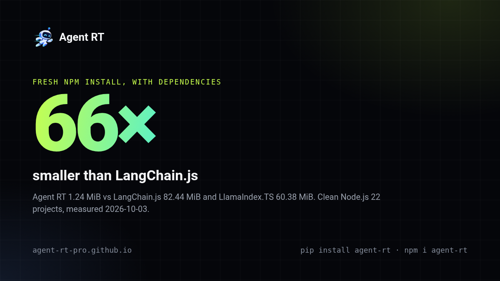

# Agent RT for TypeScript

**Production AI agents without the framework tax.** A lightweight, provider-neutral runtime with explicit control over tools, safety, state, and orchestration.

🌐 **[Website](https://agent-rt-pro.github.io/)** · [Documentation](https://agent-rt-pro.github.io/docs/) · [GitHub](https://github.com/Pro-GenAI/Agent-RT) · [Docker Hub](https://hub.docker.com/r/praneeth1v/agent-rt-typescript)

[](https://hub.docker.com/r/praneeth1v/agent-rt-typescript)
[](https://hub.docker.com/r/praneeth1v/agent-rt-typescript)

Meet **Artie**, the running robot, and its flagship features: **Guard** (blocks harmful tool calls before they run), **Checkpoints** (resume with budgets intact), and the migration **Wall** (65+ repositories passing their tests after migrating).

[](https://github.com/Pro-GenAI/Agent-RT/tree/main/comparison)

Fully typed, with a native `fetch` OpenAI-compatible transport. Start with zero provider SDKs, then add tools, approvals, memory, sandboxing, retrieval, and multi-agent orchestration as needed.

## Why Agent RT?

- **Provider-neutral.** OpenAI-compatible endpoints, OpenAI, Anthropic, or your own `ModelProvider`.
- **Safe by construction.** Tool validation, permissions, composable action blockers, approvals, deterministic PII morphing, guardrails, budgets, and deadlines are runtime primitives.
- **Scales large tool catalogs.** `Toolbase` combines local/deferred and MCP tools, safety-screens them, sends only the relevant subset per turn, and keeps `tool_search` available for fallback discovery.
- **Small core.** OpenAI, Anthropic, Agent Action Guard, and sandbox integrations are optional peers.
- **Production-ready.** Checkpoints, events, queues, tracing, cost ledgers, retrieval with post-retrieval reranking, and multi-agent patterns.
- **Decision models.** Jev-compatible models, or the OpenAI-compatible Decisions API answer typed questions that gate tool safety, tool relevance, memory, and retrieval ([details](https://agent-rt-pro.github.io/docs/guides/runtime-reference.html#action-blockers)).
- **Easy to adopt.** Migration-compatible entry points for supported subsets of OpenAI, Anthropic, OpenRouter, LangChain, Deep Agents, LlamaIndex, and OpenAI Agents code; across Agent RT's ongoing migration field testing, 65+ third-party repositories pass before and after migration.

## Install

Node 20, 22, 24, or 26. Runs on Linux, Windows, macOS (Intel and Apple M-series), and Raspberry Pi.

```bash
npm install agent-rt
```

**Docker Hub:** The prebuilt [TypeScript image](https://hub.docker.com/r/praneeth1v/agent-rt-typescript) includes Agent RT and the OpenAI/Anthropic SDK peers. It starts Node.js by default:

```bash
docker pull praneeth1v/agent-rt-typescript:latest
docker run --rm praneeth1v/agent-rt-typescript:latest node -e "console.log(typeof require('agent-rt').AgentLoop)"
```

Provider SDKs are optional: add `openai` or `@anthropic-ai/sdk` only when you need them. For agent memory, add one of `mem0ai` (the default), `@getzep/zep-cloud`, `@letta-ai/letta-client`, or `supermemory` and call `loadMemory()` ([details](https://agent-rt-pro.github.io/docs/guides/runtime-reference.html#memory-packages)). Agent RT works with the SDK versions your project already pins; releases since mid-2024 (`openai` 4.48+ through 7.x, `@anthropic-ai/sdk` 0.23+) are regression-tested.

For per-session task lists, `new TodoList().register(registry)` gives a model one `todo` tool ([details](https://agent-rt-pro.github.io/docs/guides/runtime-reference.html#task-lists-todo-tool)).

## Migrate in one line

```diff
- import OpenAI from "openai";
+ import OpenAI from "agent-rt/openai";
```

Prefix a supported import with `agent-rt/`, for example `import { ChatOpenAI } from "agent-rt/@langchain/openai"`. Across ongoing field testing, 65+ third-party repositories pass their own tests before and after this switch. See [Migration](https://agent-rt-pro.github.io/docs/guides/migration-reference.html).

Try it with no API key: `npx agent-rt demo` runs a scripted mock model through a prompt-injection attack, shows the built-in action blocker stopping `rm -rf ~` before the tool runs, totals tokens, and prints this process's peak RAM next to a competitor's published benchmark figure.

Or let Agent RT rewrite every supported import for you (after `npm install agent-rt`):

```bash
npx agent-rt migrate
```

It runs your tests before and after the rewrite and keeps it only if nothing new fails: every test that fails afterwards must have failed before, in the same test at the same line. Otherwise every file is restored. It then prints a before-and-after card (tests, test time, peak memory, package size) and, for a GitHub repository, a pre-filled issue link to add it to the migration wall. Per-test comparison needs Vitest or Jest.

Migrated? Add the opt-in [Runs on Agent RT badge](https://agent-rt-pro.github.io/docs/guides/migration-reference.html#runs-on-agent-rt-badge) to your README.

## Quick start

```ts
import {
  AgentLoop,
  loadConfig,
  loadModel,
  type AgentConfig,
  type ModelMessage,
} from "agent-rt";

// ~/.agent-rt/config.yaml by default; project files require loadConfig("./agent-rt.yaml")
const provider = await loadModel(await loadConfig());

const agent: AgentConfig = {
  name: "assistant",
  instructions: "Answer clearly and concisely.",
  model: { model: "my-model" }, // a model_name from agent-rt.yaml
};

const messages: ModelMessage[] = [
  {
    role: "user",
    content: [{ type: "text", text: "What can Agent RT do?" }],
  },
];

const result = await new AgentLoop(provider).run(agent, messages);
console.log(
  result.finalResponse?.message.content
    .filter((part) => part.type === "text")
    .map((part) => part.text ?? "")
    .join("") ?? ""
);
```

Configure several models and vector stores in `agent-rt.yaml`; secrets are referenced as `os.environ/NAME` and nothing else is read from the environment. Bedrock Knowledge Bases uses the optional `@aws-sdk/client-bedrock-agent-runtime` dependency and AWS IAM credentials. See [Configuration](https://agent-rt-pro.github.io/docs/reference/configuration.html) and the [example file](https://github.com/Pro-GenAI/Agent-RT/blob/main/agent-rt.example.yaml).

```yaml
model_list:
  - model_name: my-model
    agent_rt_params:
      model: openai/your-model        # or anthropic/..., add api_base for compatible endpoints
      api_key: os.environ/OPENAI_API_KEY
```

More examples: [`examples/`](https://github.com/Pro-GenAI/Agent-RT/tree/main/typescript/examples).

## Learn more

- [Website](https://agent-rt-pro.github.io/) and [documentation site](https://agent-rt-pro.github.io/docs/)
- [Runtime guide](https://agent-rt-pro.github.io/docs/guides/runtime-reference.html) — sandboxes, skills, providers, migration entry points
- [Architecture and Extensions](https://agent-rt-pro.github.io/docs/reference/extension-contracts.html) · [Introduction to Agent Harnesses](https://agent-rt-pro.github.io/docs/concepts/agent-harnesses.html)
- [Development](https://agent-rt-pro.github.io/docs/reference/contributor-handbook.html) · [Comparisons](https://github.com/Pro-GenAI/Agent-RT/tree/main/comparison)

For reviewed, depth-limited task delegation, use `SubagentSwarm` and `AgentLoopInvoker` with explicit per-tool read/write permissions, prepaid reviewer budgets, cancellation, and per-swarm tracing. See the [runtime guide](https://agent-rt-pro.github.io/docs/guides/runtime-reference.html#governed-subagents).
